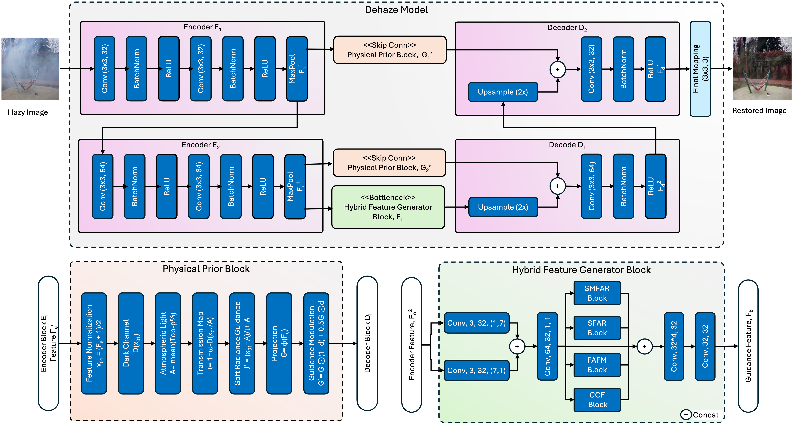

# HAFG: Haze-aware Adaptive Feature Guidance for Image Dehazing

Official PyTorch implementation of the paper **"HAFG: Haze-aware Adaptive Feature Guidance for Image Dehazing"**, accepted in *Digital Signal Processing* (2026).

**Paper:** TODO: link to the paper on the publisher's site / DOI

## Overview

HAFG is a lightweight U-Net for single image dehazing that improves two parts of the standard U-Net design. First, its **Prior-Guided Skip Connections (PGM)** add haze-aware guidance, derived from the encoder features, to each skip connection, which helps the decoder suppress residual haze while it reconstructs fine details. Second, a **Hybrid Feature Generator (HFG)** at the bottleneck combines four complementary branches through learned gated fusion, each addressing a different effect of haze. Frequency Adaptive Feature Modulation (FAFM) works in the Fourier domain to restore the high-frequency texture that haze blurs away. Spatial Attention Feature Reconstruction (SAFR) reorganizes feature channels by their spatial informativeness to keep structures and boundaries consistent. Soft Masked Adaptive Refinement Filter (SMARF) uses learnable soft masks to refine ambiguous regions with non-uniform haze. The Chroma Contrast Feature Module (CCFM) uses chromatic gradients to correct color distortion and restore natural tones.

<p align="center">
  
  <br>
  <em>Overall architecture of HAFG. Figure reproduced by the authors from S. K. Sharma and S. Mukherjee, "HAFG: Haze-aware Adaptive Feature Guidance for Image Dehazing", Digital Signal Processing, 2026, TODO: DOI link.</em>
</p>

The method, its design rationale and the experimental results are described in the paper. Please read it through the official channel linked above.

## Repository Structure

```
experiments/
    hafg_module.py      # HAFG network: prior-guided skip connections, HFG bottleneck (FAFM, SAFR, SMARF, CCFM)
    train.py            # training script
    test.py             # evaluation script
datasets/               # dataset classes
utils/
    dataset_loader.py   # dataset paths, transforms and data loaders
    loss_functions.py   # training losses
    iqa.py              # image quality metrics
    test_functions.py   # test loops (full-reference and no-reference)
    config.py           # config.json load/save helpers
```

## Environment Setup

The framework is implemented in PyTorch and runs on NVIDIA GPUs (CUDA), Apple Silicon GPUs (MPS) or the CPU. It requires Python 3.12 and PyTorch 2.6 or later.

Create the conda environment from `environment.yml`, which lists the package versions the code was tested with:

```bash
conda env create -f environment.yml
conda activate hafg
```

### Model weights downloaded on first use

Some evaluation metrics need pretrained weights, which are downloaded automatically the first time `test.py` runs:

| Metric | File | Cache folder |
|---|---|---|
| LPIPS | `alexnet-owt-7be5be79.pth` | `~/.cache/torch/hub/checkpoints/` |
| FID | `weights-inception-2015-12-05-6726825d.pth` | `~/.cache/torch/hub/checkpoints/` |
| BRISQUE | `brisque_svm_weights.pth` | `~/.cache/torch/hub/pyiqa/` |
| NIQE | `niqe_modelparameters.mat` | `~/.cache/torch/hub/pyiqa/` |

If your network blocks these downloads, download the files on another machine and copy them into the cache folders above.

## Dataset Setup

Download the benchmark datasets used in the paper from their official sources: RESIDE (SOTS, OTS and RTTS), NH-HAZE and Dense-HAZE. The RESIDE ITS training set is also supported.

Dataset paths are resolved relative to `experiments/` as `../../../datasets/`, so place a `datasets/` folder next to the repository folder (or edit the paths in `utils/dataset_loader.py`):

```
<parent folder>/
    HAFG/                   # this repository
    datasets/
        NH-HAZE/            {train,val,test}/{hazy,clear}/
        Dense-Haze/         {train,val,test}/{hazy,GT}/
        ITS/                {hazy,clear}/
        OTS/                {hazy,clear}/
        SOTS/               {indoor,outdoor}/{hazy,clear}/
        RTTS/               JPEGImages/
```

Each clear image is matched to its hazy image by the part of the file name before the first `_` (for example, `01_hazy.png` → `01.png`; Dense-Haze uses `01_GT.png`).

| `--dataset-name` | Training data | Test data |
|---|---|---|
| `nhhaze` | NH-HAZE train (val for validation) | NH-HAZE test |
| `densehaze` | Dense-Haze train (val for validation) | Dense-Haze test |
| `its` | ITS | SOTS indoor |
| `ots` | OTS (a random subset with `--train-subset`; SOTS outdoor for validation) | SOTS outdoor |
| `sots_indoor`, `sots_outdoor` | SOTS, split 80/10/10 with a fixed seed | SOTS |
| `rtts` | — (test only, no ground truth) | RTTS |

## Training

```bash
cd experiments
python train.py --dataset-name nhhaze --experiment-name hafg
```

The default settings in `train.py` (optimizer, learning-rate schedule, number of epochs, batch size, loss weights and augmentation) follow the implementation details in the paper. Run `python train.py --help` for the full list of options.

Ablation options:

- Switch components off with `--no-pgm`, `--no-fafm`, `--no-safr`, `--no-smarf` and `--no-ccfm`.
- Select the PGM pooling operation with `--pgm-pool {min,max,mean}` (default `min`).

Outputs are written to `data/<dataset>_<experiment-name>/`.

## Evaluation

### Evaluating the provided checkpoints

Download the checkpoints from the <!-- TODO: link to the GitHub Release --> page and place them in `data/checkpoints/`:

```
data/checkpoints/
    nhhaze.pth          # NH-HAZE
    densehaze.pth       # Dense-HAZE
    sotsindoor.pth      # SOTS indoor
```

Evaluate each checkpoint on the test split of its benchmark:

```bash
cd experiments
python test.py --dataset-name nhhaze      --experiment-name released --checkpoint ../data/checkpoints/nhhaze.pth
python test.py --dataset-name densehaze   --experiment-name released --checkpoint ../data/checkpoints/densehaze.pth
python test.py --dataset-name sots_indoor --experiment-name released --checkpoint ../data/checkpoints/sotsindoor.pth
```

The NH-HAZE and Dense-HAZE models are tested on the 5 test pairs of each dataset. The SOTS indoor model is tested on the test part of the random 80/10/10 split described in [Dataset Setup](#dataset-setup).

**Note on the provided checkpoints:** they were trained with all the loss terms for a longer schedule than the default 250 epochs of `train.py`, followed by fine-tuning with the loss factors and learning rates. A model retrained with the default settings may therefore give different results.

### Evaluating your own trained model

Evaluate a model trained with `train.py` on the test split of its dataset:

```bash
cd experiments
python test.py --dataset-name nhhaze --experiment-name hafg
```

To evaluate on real-world hazy images (RTTS, no-reference metrics only), use `--test-dataset-name`. As in the paper, the RTTS model is trained on 1000 randomly selected OTS pairs and validated on SOTS outdoor:

```bash
python train.py --dataset-name ots --experiment-name hafg --train-subset 1000
python test.py --dataset-name ots --experiment-name hafg --test-dataset-name rtts
```

### Output and options

On paired datasets, `test.py` reports the full-reference metrics PSNR, SSIM, LPIPS and FID. It also reports the no-reference metrics BRISQUE, NIQE, PIQE and FADE, as well as the parameter count and MACs. The results are saved to `test_best_values.txt` in `data/<dataset>_<experiment-name>/`, together with comparison images.

By default, test images are resized to 256×256, the training resolution, with a bicubic filter. Use `--test-size N` to resize them to N×N instead, `--resize bilinear` to resize with a bilinear filter, or `--full-res` to test at the original image resolution.

## Citation

If you find this work useful, please cite our paper:

```bibtex
@article{sharma2026hafg,
    title={HAFG: Haze-aware Adaptive Feature Guidance for Image Dehazing},
    author={Santosh Kumar Sharma and Snehasis Mukherjee},
    journal={Digital Signal Processing},
    publisher = {Elsevier},
    year={2026}
}
```

## License

The source code in this repository is released under the MIT License. See `LICENSE` for details.

The MIT License covers the source code only. It does not cover the paper or the architecture figure taken from it, which are subject to the publisher's terms. The paper itself is not included in this repository. Please access it through the publisher via the DOI above.
